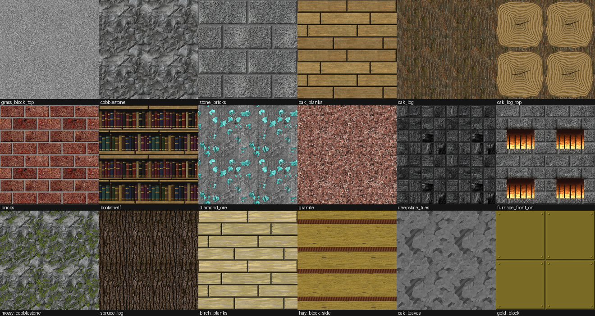

# Mellow Realistic PBR

Реалистичный ресурс-пак для Minecraft Java с **PBR** и **POM** (parallax occlusion mapping),
настроенный под шейдер **[Mellow](https://modrinth.com/shader/mellow)** (3.0+, поддержка labPBR 1.3).
Совместим и с любым другим шейдером, который читает labPBR 1.3 (BSL, Complementary, Bliss и т. д.).



*Превью: каждая текстура показана плиткой 2×2 (видно, что нет швов) и освещена по картам `_n`/`_s`.*

## Что внутри

- **292 текстуры блоков в 256x**, у каждой три карты: `name.png` (альбедо),
  `name_n.png` (нормали + AO + высота), `name_s.png` (спекуляр).
- Альбедо и рельеф построены из **фотосканов CC0** (ambientCG): камень, кора, древесина, почва,
  мох, лёд, металл, ткань, настоящие листья и травинки, вырезанные из фото-атласов.
- Раскладка повторяет ванильную, чтобы блоки оставались узнаваемыми: 4 ряда досок со швами и гвоздями,
  кирпичная кладка с раствором, годичные кольца на торцах брёвен, книги на полках и т. п.
- Все текстуры бесшовные (тайлинг проверен).

| Группа | Блоки |
|---|---|
| Камень | stone, cobblestone (+mossy), stone bricks (+mossy/cracked/chiseled), smooth stone, granite/diorite/andesite (+polished), calcite, tuff, deepslate (cobbled, polished, bricks, tiles, cracked), bedrock, obsidian, crying obsidian |
| Руды | все 8 руд в камне и в глубинном сланце, nether gold, nether quartz |
| Почва | dirt, coarse/rooted dirt, grass block (верх, бок, оверлей, снег), podzol, mycelium, dirt path, farmland (сухая/влажная), mud, clay, gravel, sand, red sand, sandstone и red sandstone (все грани + cut), snow, powder snow, ice, packed ice, blue ice, moss block |
| Дерево | oak, spruce, birch, jungle, acacia, dark oak, mangrove, cherry, pale oak — доски, бревно, торец, ободранное бревно и его торец |
| Растения | листва всех пород + azalea, short grass, tall grass, fern |
| Постройки | bricks, glass, bookshelf, crafting table, furnace (вкл./выкл.), quartz (все), hay bale |
| Металлы и камни | iron, gold, netherite, copper (4 стадии окисления + cut), diamond, emerald, lapis, redstone, coal blocks |
| Незер и Энд | netherrack, nether bricks (red, cracked), soul sand/soil, blackstone (+polished, bricks), basalt (+polished, smooth), glowstone, magma (анимированная), end stone (+bricks) |
| 16 цветов | wool, concrete, concrete powder, terracotta, stained glass (+панели) |

Блоки, которых нет в списке, остаются ванильными.

## PBR-данные (labPBR 1.3)

Формат проверен по исходному коду Mellow (`global/pbr.glsl`, `global/lighting/*.glsl`):

| Карта | Канал | Значение |
|---|---|---|
| `_n` | R, G | нормаль (DirectX, Y вниз) |
| `_n` | B | ambient occlusion |
| `_n` | A | высота для POM (255 — поверхность, 1 — максимальная глубина) |
| `_s` | R | гладкость (perceptual smoothness) |
| `_s` | G | F0 0–229 для диэлектриков; 230 железо, 231 золото, 232 алюминий, 234 медь |
| `_s` | B | 0–64 пористость (намокание под дождём), 65–255 подповерхностное рассеивание (листва, трава, снег, шерсть) |
| `_s` | A | свечение (руды редстоуна, светокамень, магма, горящая печь, плачущий обсидиан) |

## Установка

1. Установите **Iris** (или OptiFine) и шейдер **Mellow 3.0+**.
2. Скачайте пак: **Code → Download ZIP** на GitHub и распакуйте архив в папку
   `.minecraft/resourcepacks` (внутри должна получиться папка с `pack.mcmeta` в корне).
   Либо соберите zip сами (см. ниже).
3. Включите пак в *Настройки → Пакеты ресурсов*.
4. Поддерживаются версии **1.20 – 1.21.x** (`pack_format` 15, диапазон до новых версий).

## Настройка Mellow

PBR в Mellow по умолчанию выключен. Откройте
*Настройки шейдера → Materials & labPBR* и включите:

| Опция | Значение |
|---|---|
| **Normal Texture** | ON (обязательно — без неё не работает и POM) |
| **Specular Texture** | ON |
| **POM** | ON |
| POM Settings → Parallax Steps | 48–64 (ниже — быстрее) |
| POM Settings → Parallax Max Depth | 0.25 (стандарт labPBR) |
| POM Settings → Parallax Shadowing | ON |
| Specular Settings → Resourcepack Reflections | ON |
| Reflections | Raytraced (лучше всего вместе с TAA) |
| Subsurface Scattering | 0.6–0.8 (нужны *Terrain & Lighting → Dynamic Shadows*) |

POM в Mellow применяется к блокам мира, к предметам в руке и к сущностям; на расстоянии больше ~12 блоков
он плавно отключается (так задумано в шейдере ради производительности).

## Сборка из исходников

Текстуры генерируются скриптами в `tools/` (Python 3.10+, `numpy`, `scipy`, `Pillow`).
Исходные CC0-материалы скачиваются автоматически с ambientCG в `.cache/`.

```bash
pip install numpy scipy pillow
python3 tools/build.py --clean                     # 256x в корень репозитория
python3 tools/build.py --res 128 --out build/128 \
        --zip build/Mellow-Realistic-PBR-128x.zip  # облегчённая версия для слабых ПК
python3 tools/build.py --res 512 --out build/512    # 512x (качает 2K-исходники)
python3 tools/build.py --only wood_oak ores         # пересобрать отдельные рецепты
python3 tools/preview.py out.png --all              # лист-превью всех текстур
```

Структура генератора:

- `tools/pbrlib.py` — материалы, бесшовный кроп/масштаб, шумы, вороной, раскладки, экспорт в labPBR;
- `tools/recipes_natural.py` — камни, руды, почва, незер/энд;
- `tools/recipes_wood.py` — доски, кора, годичные кольца;
- `tools/recipes_plants.py` — трава, листва (раскладка фото-листьев), растения;
- `tools/recipes_built.py` — кирпичи, стекло, книжная полка, верстак, печь, металлы, сено;
- `tools/recipes_colored.py` — шерсть, бетон, терракота, витражи.

## Лицензия

Код генератора — MIT, текстуры — CC0 (созданы только из CC0-материалов). Подробнее в
[LICENSE](LICENSE) и [CREDITS.md](CREDITS.md).
