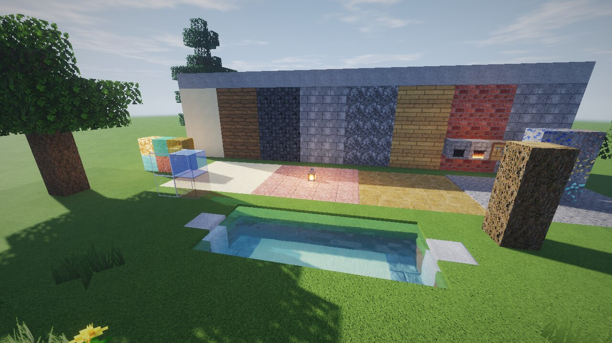
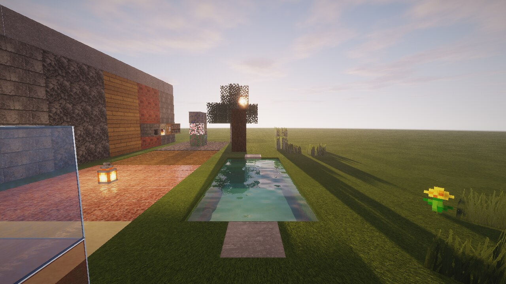
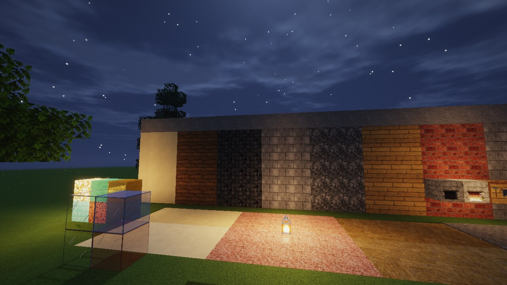
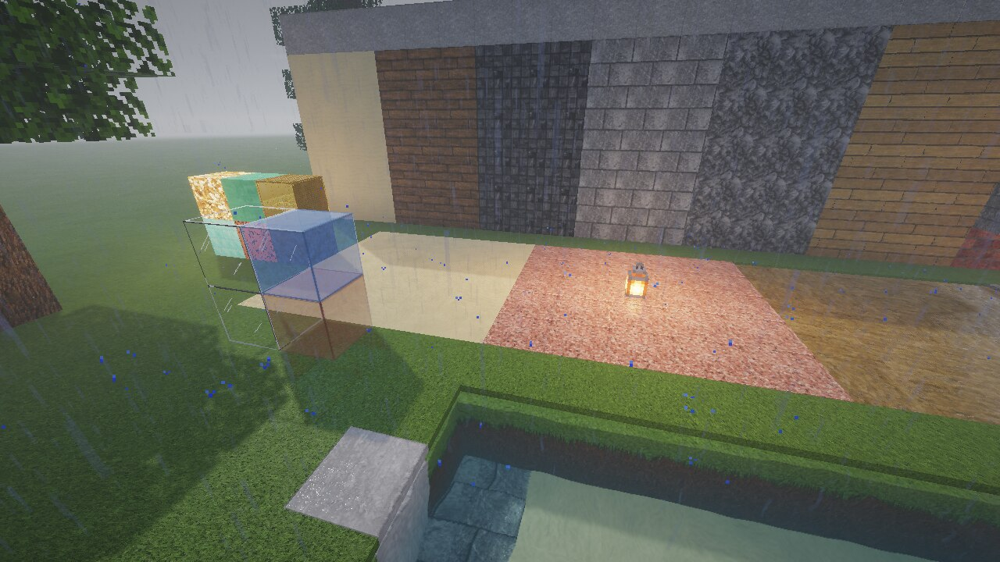
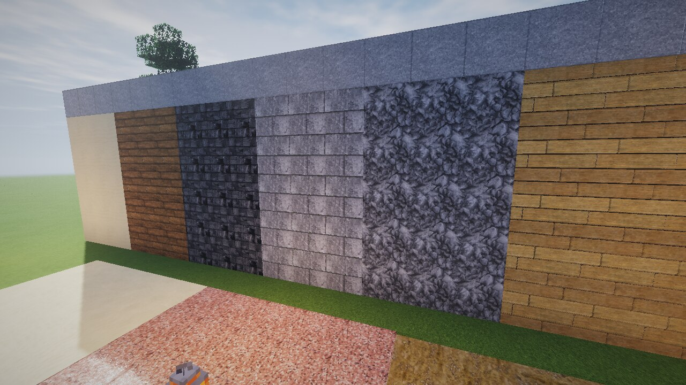

# Realistic PBR Shaders

Шейдерпак для **Iris** (и OptiFine), написанный под ресурс-пак
**Mellow Realistic PBR** из этого репозитория. Полностью читает labPBR 1.3, поэтому подходит
и для других labPBR-паков.

## Возможности

- **labPBR 1.3**: карты нормалей, AO, гладкость, F0 и предопределённые металлы (железо, золото,
  медь…), пористость, подповерхностное рассеивание, свечение.
- **POM**: параллакс с учётом атласа и самозатенением рельефа.
- **Тени**: мягкие тени (PCF), цветные тени от витражей, колыхание теней от листвы.
- **Освещение**: GGX-спекуляр, свет неба, тёплый свет блоков, свет от факела в руке, SSS для листвы и травы.
- **Отражения**: экранные отражения (SSR) на гладких материалах и металлах, с откатом на отражение неба.
- **Вода**: процедурные волны, преломление, поглощение по глубине, отражения, блики солнца, подводный туман.
- **Небо**: процедурная атмосфера с рассветами и закатами, гало солнца и луны, процедурные облака
  с самозатенением, звёзды и луна.
- **Погода**: дождь, мокрые пористые блоки, лужи на твёрдых горизонтальных поверхностях.
- **Атмосфера**: туман по высоте и расстоянию, скрытие края прорисовки, лучи света (god rays).
- **Постобработка**: блум, автоэкспозиция, тонмаппинг ACES, виньетка.
- **Незер и Энд**: свои варианты освещения и тумана (`world-1/`, `world1/`).
- **Меню настроек** на русском и английском, профили Низкие / Средние / Высокие / Ультра.

## Установка

1. Установите **Iris** (вместе с Sodium) для своей версии Minecraft.
2. Положите `Realistic-PBR-Shaders.zip` (или папку `shaderpack/`) в `.minecraft/shaderpacks`.
3. Включите ресурс-пак **Mellow Realistic PBR** и выберите шейдер в *Настройки → Шейдеры*.

## Проверка

- Каждая программа во всех трёх измерениях и с каждой отключённой опцией компилируется через
  `glslangValidator`: `python3 tools/check_shaders.py`.
- Пак запускали в Minecraft 1.21.10 с Iris 1.9.7 (Mesa llvmpipe, OpenGL 4.5): день, закат, ночь,
  дождь и Незер.

| | |
|---|---|
|  |  |
|  |  |
